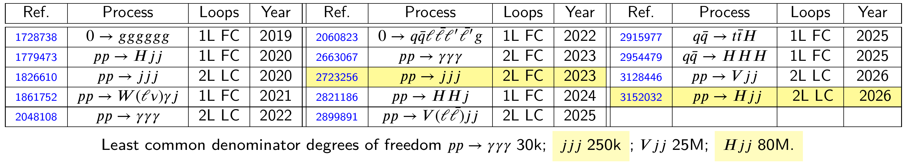

<!---

--->

<section>



<h3 style="margin-top: 2mm; margin-left: -10mm; margin-right: -10mm; margin-bottom: -5mm;">
	<b style="margin-top:15mm; font-size: 30pt; text-transform: none; font-variant-caps: small-caps;">
     Analytic Multi-Loop Helicity Amplitudes in QCD
     </b>
</h3>

     Giuseppe De Laurentis

     The full physical information of a color-ordered helicity amplitude is in the finite remainder:

 
<a href=https://www.sciencedirect.com/science/article/abs/pii/S0370269398003323?via%3Dihub>Catani ('98) </a> 

 
<a href=https://journals.aps.org/prl/abstract/10.1103/PhysRevLett.102.162001>Becher, Neubert ('09) </a>

 
<a  href=https://arxiv.org/abs/0901.1091>Gardi, Magnea ('09) </a> 

 
<a href=https://inspirehep.net/literature/920274>Weinzierl ('11) </a>

$$ 
\textstyle \mathcal{R}^{\ell-\text{loop}}_{n-\text{point}}(|i⟩_{\alpha}, [i|_{\dot\alpha}) = \sum_i {\color{red}{r_{i}}}(|i⟩_{\alpha}, [i|_{\dot\alpha}) \, {\color{blue}{G_i}}(|i⟩_{\alpha} {\scriptsize\times} [i|_{\dot\alpha}) \, .
$$

     <b><i>Challenges:</i></b>

     $\circ$ Compute the $\color{blue}{G_i}\,$, a basis of transcendental functions, e.g. the <i>Pentagon Functions</i>;

<a style="font-size: 13pt; display: inline-block; text-align: right; float: right; margin-top: -2mm; margin-bottom: -2mm; margin-left: 2mm;" href=https://arxiv.org/abs/2306.15431> + Abreu, Ita, Page, Tschernow ('23) </a>
<a style="font-size: 13pt; display: inline-block; text-align: right; float: right; margin-top: -2mm; margin-bottom: -2mm; margin-left: 2mm;" href=https://arxiv.org/abs/2110.10111> + Zoia ('21) </a>
<a style="font-size: 13pt; display: inline-block; text-align: right; float: right; margin-top: -2mm; margin-bottom: -2mm; margin-right: 0mm; " href=https://arxiv.org/abs/2009.07803> Chicherin, Sotnikov ('20) </a> 

     $\circ$ Reconstruct the $\color{red}{r_{i}}\,$, functions in the field of fractions over a polynomial quotient ring,

<a style="font-size: 13pt; display: inline-block; text-align: right; float: right; margin-top: -2mm; margin-bottom: -2mm; margin-left: 2mm;" href=https://arxiv.org/abs/1406.4513>
GDL, Page ('22).
</a>
<a style="font-size: 13pt; display: inline-block; text-align: right; float: right; margin-top: -2mm; margin-bottom: -2mm; margin-left: 2mm;" href=https://arxiv.org/abs/1406.4513>
GDL, Maitre ('19);
</a>
<a style="font-size: 13pt; display: inline-block; text-align: right; float: right; margin-top: -2mm; margin-bottom: -2mm; margin-left: 2mm;" href=https://arxiv.org/abs/1608.01902>
Peraro ('16); 
</a>

$$
\displaystyle \kern10mm R_{n} = \mathbb{F}\Big[|1⟩_{\alpha}, [1|_{\dot\alpha}, \dots, |n⟩_{\alpha}, [n|_{\dot\alpha} \Big] \Big/ J \qquad \text{with} \qquad J = \text{Ideal} \Big( {\textstyle \sum_{i=1}^n} |i\rangle[ i | \Big) \, ,
$$

     $\phantom{\circ}$ in connection with algebraic geometry, and extended to massive particles (spin-spinors).

 
<a href="https://arxiv.org/abs/1709.04891"> Arkani-Hamed, Huang, Huang ('17); </a> 
<a href="https://arxiv.org/abs/1802.06730"> Ochirov ('18); </a>
<a href="https://arxiv.org/abs/1809.09644"> Shadmi, Weiss ('18); </a> 
<a href="https://arxiv.org/abs/arXiv:2504.19909"> Campbell, GDL, Ellis ('25); </a>
<a href="https://arxiv.org/abs/arXiv:2603.10269"> GDL, Melnikov, Tresoldi ('26) </a>

     <b><i>Amplitudes we computed:</i></b> $\kern3mm$ GDL + [Abreu, Campbell, Ellis, Ita, Klinkert, Kuschke, Maitre, Page, Ruf, Seth, Sotnikov, ...]

$\color{red}{r_{i}}\,$ known since
<a style="font-size: large; display: inline-block; text-align: right; float: right; margin-top: 2mm; margin-right: 0mm; " href=https://arxiv.org/abs/2605.04009> GDL, Ita, Kuschke, Ruf, Sotnikov ('26) </a> 

LCD d.o.f.: 30K, 250K, 25M, 80M

</section>

<!-- REVEAL.JS CUSTOMIZATION -->

<!-- Include MathJax library -->

<!-- Include Reveal.js and the Math plugin -->

<!-- Initialize Reveal.js with the MathJax plugin -->

